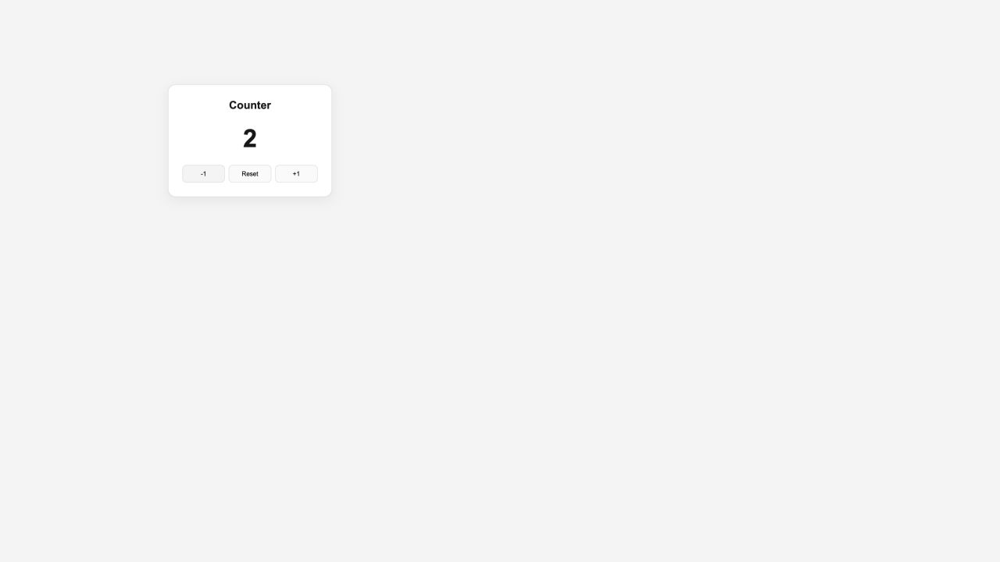

# OZ 코딩스쿨 워크북

OZ 코딩스쿨에서 배운 내용을 복습하고 일별 과제를 정리하는 워크북입니다.

## 과제 목록

| 날짜 | 과제 | 학습 내용 |
| --- | --- | --- |
| Day 40 | [Zustand 카운터](./day40-zustand) | Store 생성, 상태 변경, selector 사용 |
| 프론트엔드 최종 과제 | [TodoFlow 실시간 할 일 관리](./todo-flow-final) | TypeScript, Firestore CRUD·실시간 구독, Redux Toolkit, Next.js 라우팅, 다크모드 |

## 기존 공개 저장소 과제

각 저장소의 `main` 브랜치 파일을 폴더별로 모았습니다. 원본 Git 기록과 추가 브랜치는 [백업 폴더](./_archive)에 보관했습니다. 이 폴더들은 가져온 시점의 사본이며 자동 동기화되지 않습니다. 원본 커밋은 [가져오기 기록](./import-sources.json)에서 확인할 수 있습니다.

| 과제 폴더 | 원본 저장소 |
| --- | --- |
| [git-practice](./git-practice) | [원본](https://github.com/dadaroo247-web/git-practice) |
| [html-css-portfolio](./html-css-portfolio) | [원본](https://github.com/dadaroo247-web/html-css-portfolio) |
| [javascript-assignment](./javascript-assignment) | [원본](https://github.com/dadaroo247-web/javascript-assignment) |
| [JavaScript-final](./JavaScript-final) | [원본](https://github.com/dadaroo247-web/JavaScript-final) |
| [movie-app-deploy-practice](./movie-app-deploy-practice) | [원본](https://github.com/dadaroo247-web/movie-app-deploy-practice) |
| [my-first-page](./my-first-page) | [원본](https://github.com/dadaroo247-web/my-first-page) |

각 프로젝트는 해당 폴더를 기준으로 실행합니다. 원본 저장소를 삭제하면 기존 GitHub Pages 주소는 더 이상 제공되지 않을 수 있습니다.

## Day 40 실행

```bash
cd day40-zustand
npm install
npm run dev
```

브라우저에서 http://localhost:3000 에 접속합니다.

초기값은 0이며, +1·-1·Reset 버튼으로 값을 변경합니다.

## 실행 결과

`+1 → +1 → +1 → -1` 순서로 클릭하면 2가 표시됩니다.



## 검증

- `npm run build` 및 TypeScript 검사 통과
- 초기값, 증가, 감소, 음수, Reset 동작 확인
- 브라우저 콘솔 오류 없음

새 과제는 `day41-과제이름`처럼 별도 폴더에 추가합니다.

## TodoFlow 최종 과제

[TodoFlow 구현본](./todo-flow-final)에 필수 과제 1~7과 선택 과제(삭제, 다크모드, `useSettings`)를 모두 구현했습니다. 설치·린트·빌드 및 자동 테스트 26개를 검증했고, 실제 무료 Spark Firebase 프로젝트를 연결해 [추가·완료 변경·삭제·두 창 간 실시간 동기화](./todo-flow-final/FIREBASE_STATUS.md)까지 확인했습니다.

```bash
cd todo-flow-final
npm install
cp .env.local.example .env.local
# 실제 Firebase 웹 앱 설정값 6개를 .env.local에 입력한 뒤 실행합니다.
npm run dev
```

설정 방법은 [TodoFlow README](./todo-flow-final/README.md), 전체 수정 파일과 검증 범위는 [구현 보고서](./todo-flow-final/IMPLEMENTATION.md)를 참고하세요.
