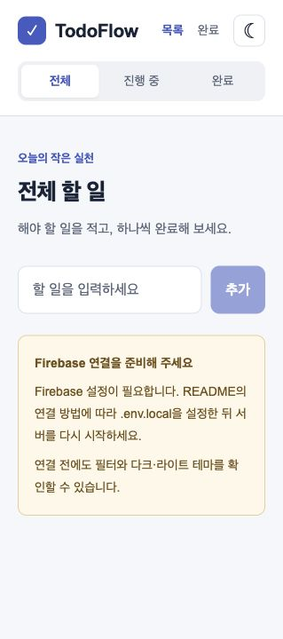
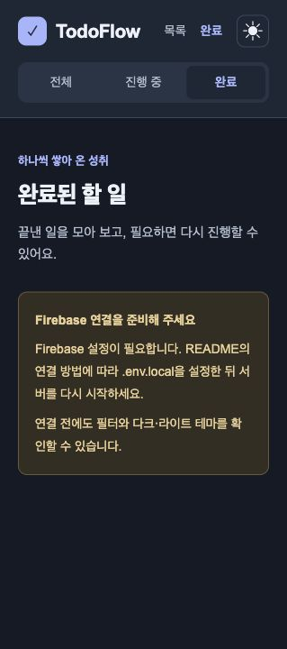

# TodoFlow — 실시간 할 일 관리 앱

Next.js App Router, TypeScript, Firebase Firestore, Redux Toolkit으로 구현한 프론트엔드 최종 과제입니다. 할 일은 Firestore에 저장하고, 화면의 테마와 목록 필터는 Redux 및 redux-persist로 관리합니다.

필수 과제 1·3~7과 선택 과제인 삭제, 다크모드, `useSettings`를 구현했습니다. **과제 2의 초기화 코드와 설정 안내는 준비되어 있지만, 실제 Firebase 설정값이 제공되지 않아 실제 프로젝트 연결과 실시간 CRUD 검증은 남아 있습니다.** `.env.local.example`은 빈 설정 템플릿 그대로 유지했습니다.

## 실행하기

이 구현본은 **Node.js 24.21.0 / npm 11.19.0**에서 검증했습니다. 설치된 개발·테스트 도구까지 포함하면 Node.js **20.19 이상(20.x), 22.13 이상(22.x), 또는 24 이상**을 사용하세요. 원본 Next.js의 최소 요구사항(20.9)보다 테스트 도구의 요구사항이 높습니다.

```bash
git clone https://github.com/dadaroo247-web/oz-coding-school-workbook.git
cd oz-coding-school-workbook/todo-flow-final
npm install
cp .env.local.example .env.local
```

이 구현본은 워크북 저장소의 `todo-flow-final` 폴더에 있습니다. 그 폴더의 `package.json`을 기준으로 명령을 실행하세요. [원본 스켈레톤](https://github.com/ozedu5/frontend-final)은 저장소 최상위에 앱이 있는 구조이며, 해당 원본을 그대로 클론하면 폴더 이름은 `frontend-final`입니다.

아래 Firebase 설정을 채운 뒤 실행합니다.

```bash
npm run dev
```

브라우저에서 [http://localhost:3000](http://localhost:3000)을 엽니다. 환경변수를 수정했다면 개발 서버를 다시 시작하세요.

설정값이 없는 상태에서도 화면과 테마 전환을 확인할 수 있습니다. 이때 Firebase 설정 안내를 표시하고 할 일 쓰기를 막습니다. 로컬 가상 데이터로 저장 성공을 대신하지 않으므로, 실제 목록을 사용하려면 Firebase 연결이 필요합니다.

## Firebase 설정 — 사용자가 완료할 과제 2

1. [Firebase Console](https://console.firebase.google.com/)에서 프로젝트를 생성하거나 수업용 프로젝트를 선택합니다.
2. **프로젝트 설정 → 내 앱 → 웹 앱 추가**에서 앱을 등록하고 SDK 설정 및 구성의 값을 확인합니다.
3. **Firestore Database**를 생성합니다. 이 앱은 `getFirestore(app)`로 기본 **`(default)` 데이터베이스**를 사용합니다.
4. 프로젝트 루트의 `.env.local`에 웹 앱의 실제 설정값 6개를 입력합니다. 아래 값 이름은 SDK 설정의 속성과 대응합니다.

| 환경변수 | Firebase SDK 설정 속성 |
| --- | --- |
| `NEXT_PUBLIC_FIREBASE_API_KEY` | `apiKey` |
| `NEXT_PUBLIC_FIREBASE_AUTH_DOMAIN` | `authDomain` |
| `NEXT_PUBLIC_FIREBASE_PROJECT_ID` | `projectId` |
| `NEXT_PUBLIC_FIREBASE_STORAGE_BUCKET` | `storageBucket` |
| `NEXT_PUBLIC_FIREBASE_MESSAGING_SENDER_ID` | `messagingSenderId` |
| `NEXT_PUBLIC_FIREBASE_APP_ID` | `appId` |

```dotenv
NEXT_PUBLIC_FIREBASE_API_KEY=
NEXT_PUBLIC_FIREBASE_AUTH_DOMAIN=
NEXT_PUBLIC_FIREBASE_PROJECT_ID=
NEXT_PUBLIC_FIREBASE_STORAGE_BUCKET=
NEXT_PUBLIC_FIREBASE_MESSAGING_SENDER_ID=
NEXT_PUBLIC_FIREBASE_APP_ID=
```

`.env.local`은 Git 추적 대상에서 제외됩니다. 실제 값을 소스 코드나 `.env.local.example`에 작성하지 마세요. `NEXT_PUBLIC_` 값은 브라우저에 전달되는 Firebase 웹 앱 설정이며, 데이터 접근 권한은 Firestore 보안 규칙으로 제어합니다. 서비스 계정 JSON이나 관리자 비밀 키는 이 파일에 넣지 않습니다.

### 수업용 데이터베이스와 접근 규칙

이 과제에는 로그인과 사용자별 소유권 기능이 없습니다. 연결된 프로젝트의 `todos` 컬렉션 하나를 모든 접속자가 공유합니다. 수업 실습용 별도 프로젝트에서는 Firestore 생성 시 테스트 모드로 잠깐 확인할 수 있으나, 콘솔에 표시되는 규칙 만료일을 확인하고 실습이 끝나면 접근을 제한하세요. 테스트 모드는 다른 사람의 읽기·쓰기도 허용하므로 개인정보를 저장하거나 이 규칙 그대로 공개 배포하지 않습니다. 운영 배포에는 인증 및 사용자별 데이터 접근 규칙 구현이 추가로 필요합니다. [Firebase의 테스트 모드 설명](https://firebase.google.com/docs/firestore/quickstart), [Firestore 보안 규칙 설정](https://firebase.google.com/docs/firestore/security/get-started)을 참고하세요.

규칙이 읽기·쓰기를 거부하면 앱에서 오류를 표시합니다. `permission-denied`가 발생하면 프로젝트 선택, 기본 데이터베이스 생성 여부, 규칙과 테스트 기간을 확인하세요. 환경변수를 모두 채웠다고 연결이나 접근 권한이 자동으로 검증되는 것은 아닙니다.

### 저장 구조

최초 추가 시 `todos` 컬렉션에 자동 ID 문서가 생성됩니다.

| 항목 | 형식 | 저장 방식 |
| --- | --- | --- |
| 문서 ID | 문자열 | `addDoc`이 생성하며 앱의 `Todo.id`로 사용 |
| `text` | 문자열 | 앞뒤 공백을 제거한 할 일 내용 |
| `isDone` | 불리언 | 생성 시 `false`, 완료 토글 시 반전 |
| `createdAt` | Firestore Timestamp | 생성 시 `serverTimestamp()` 사용 |

`createdAt`을 기준으로 내림차순 정렬하여 최신 항목을 위에 표시합니다. 서버 타임스탬프가 확정되기 전에는 로컬 추정 시간을 읽고, 유효한 Timestamp가 없을 때에는 `Todo.createdAt`을 `null`로 처리합니다. 콘솔에서 수동으로 문서를 추가할 때에도 `createdAt`을 Timestamp로 지정하세요.

## 과제별 구현

| 구분 | 구현 내용 | 주요 파일 |
| --- | --- | --- |
| 과제 1 | `Todo`, `'all' \| '진행 중' \| '완료'`, `'light' \| 'dark'` 타입 | `src/types/todo.ts` |
| 과제 2 | 환경변수 기반 초기화 및 설정 누락 안내. 실제 설정·연결 검증은 사용자 작업 | `src/lib/firebase.ts`, `.env.local.example` |
| 과제 3 | 테마 토글 및 필터 변경 reducer | `src/store/todoSlice.ts` |
| 과제 4 | `onSnapshot` 실시간 구독, 최신순 정렬, 구독 오류 처리와 해제 | `src/components/todo/TodoList.tsx` |
| 과제 5 | `addDoc`과 `serverTimestamp`로 추가, 빈 입력 방지 | `src/components/todo/TodoInput.tsx` |
| 과제 6 | `updateDoc`으로 `isDone` 변경 | `src/components/todo/TodoList.tsx` |
| 과제 7 | `/completed`에서 완료 항목만 표시 | `src/app/completed/page.tsx` |
| 선택: 삭제 | `deleteDoc`으로 문서 삭제, 완료 토글과 별도 조작 | `src/components/todo/TodoList.tsx` |
| 선택: 다크모드 | 배경, 내비게이션, 입력창, 목록, 안내 문구에 테마 적용 | `src/components/layout/ThemeWrapper.tsx`, `src/app/globals.css` |
| 선택: 커스텀 훅 | `theme`, `filter` 및 변경 함수를 `useSettings`로 묶음 | `src/hooks/useSettings.ts` |

`useSettings`의 변경 함수는 `useCallback`으로 참조를 유지합니다. 테마와 필터는 redux-persist를 통해 브라우저 localStorage에 저장되어 새로고침 후 복구됩니다. 할 일 자체는 Redux/localStorage에 복제하지 않고 Firestore 구독으로 읽습니다.

`/`에서는 Redux의 전체·진행 중·완료 필터를 적용합니다. `/completed`는 `TodoList`를 재사용하면서 페이지 전용 완료 필터를 우선 적용합니다. 따라서 내비게이션 필터나 저장된 필터가 바뀌더라도 `/completed`에 미완료 항목이 섞이지 않습니다.

목록 로딩, 빈 목록, 설정 누락, 읽기·쓰기 실패를 구분해 표시합니다. 저장·변경 중 중복 조작을 막고, 추가가 실패하면 입력 내용을 유지해 재시도할 수 있게 합니다.

## 확인 명령

```bash
npm run lint
npm test
npm run build
```

`npm test`는 Firestore 응답을 모의해 목록 구독·필터·추가·변경·삭제·오류 처리를 검증합니다. 실제 Firebase 서버에 접속하지 않습니다. 테스트를 수정하면서 반복 실행하려면 `npm run test:watch`를 사용하세요. 최종 검증 결과와 수정 파일 목록은 [IMPLEMENTATION.md](./IMPLEMENTATION.md)에 정리했습니다.

프로덕션 빌드를 실행하려면 빌드 완료 후 `npm run start`를 사용합니다. `NEXT_PUBLIC_` 환경변수는 빌드 시 포함되므로, 배포 환경의 값은 빌드 전에 등록하고 값을 바꾸면 다시 빌드하세요. lint/build 성공은 실제 Firebase 서비스와의 통신 검증을 대신하지 않습니다.

## 제출 전 수동 확인

실제 Firebase 프로젝트를 연결한 뒤 다음을 확인합니다.

- [ ] 공백만 있는 입력은 저장되지 않는다.
- [ ] 할 일을 추가하면 최신 항목이 위에 나타나며 새로고침해도 유지된다.
- [ ] 브라우저 두 창에서 한쪽의 추가·완료 변경·삭제가 다른 쪽에 실시간으로 반영된다.
- [ ] 항목의 완료 상태를 바꾸면 진행 중·완료 필터 결과도 바뀐다.
- [ ] 삭제 버튼은 해당 문서만 삭제하며 완료 상태를 별도로 토글하지 않는다.
- [ ] `/`의 전체·진행 중·완료 필터가 맞는 목록을 표시한다.
- [ ] `/completed`로 직접 진입하거나 새로고침해도 완료된 항목만 표시된다.
- [ ] `/completed`에서 다른 필터를 조작해도 그 경로에 미완료 항목이 표시되지 않는다.
- [ ] 테마 버튼을 누르면 내비게이션·입력창·목록까지 라이트/다크 색상이 바뀐다.
- [ ] 새로고침 후 테마와 필터 설정이 유지된다.
- [ ] 설정 누락과 Firestore 접근 거부 시 안내가 표시되고 입력 내용이 불필요하게 사라지지 않는다.
- [ ] `npm run lint`, `npm run build` 결과를 확인한다.

제출 자료에는 구현한 GitHub 저장소 링크 또는 실행 화면을 포함하고, 선택 과제 3가지 구현을 표시합니다. 실제 Firebase 설정 전이라면 설정 대기 상태와 연결 후 확인이 필요한 항목을 함께 적습니다. `GUIDE.md`는 원본 과제 설명이며, 구현 및 실행 방법은 이 README를 기준으로 확인하세요.

## 실행 화면

아래는 실제 Firebase 설정 전의 화면입니다. 실제 Firebase 연결 검증은 설정 후 진행해야 합니다.




